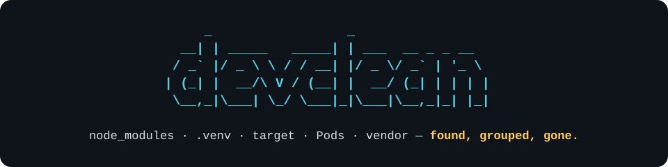
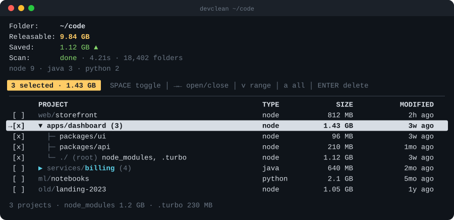

<p align="center">
  
</p>

<p align="center">
  <a href="https://github.com/lv-tinh-25/devclean/actions/workflows/ci.yml"></a>
  
  
</p>

**Your disk is full of projects you finished months ago. devclean finds what they left behind.**
One keystroke-driven screen lists every project under a folder, shows what you can safely throw away and when you last touched it — then deletes it, or reinstalls it when you need it again.

<p align="center">
  
</p>

## Table of Contents

- [Features](#features)
- [Install](#install)
- [Usage](#usage)
  - [Keys](#keys)
- [Supported projects](#supported-projects)
- [How it works](#how-it-works)
- [Development](#development)
- [License](#license)

<a name="features"></a>

## ✨ Features

- **One row per project**  
  `node_modules`, `.next`, `.turbo` and `dist` of the same project are counted together, so you decide per project, not per folder.

- **Monorepos stay together**  
  Packages and Maven modules collapse under their parent project. Open the group to pick individual ones.

- **Sorted by when you stopped working**  
  The newest code change in each project drives the order — forgotten projects sink to the bottom, where they are safest to clean.

- **Delete with eyes open**  
  Every folder that will be removed is listed with its size before you confirm. Source, tests and `.env` files are never touched.

- **Reinstall in one key**  
  Need a project again? <kbd>i</kbd> runs the right installer — `pnpm`, `yarn`, `bun`, `npm`, `uv`, `poetry`, `mvn`, `gradle`, `cargo`, `pod`, `composer`.

- **Honest numbers**  
  Hard-linked files don't count toward "Releasable", and `dist`/`build` are only offered when git ignores them.

<a name="install"></a>

## 📦 Install

```bash
npx devclean            # run without installing
npm i -g devclean       # or install globally
```

Requires Node.js 22 or newer.

<a name="usage"></a>

## 🚀 Usage

```bash
devclean                # scan the current directory
devclean ~/Documents    # scan a specific directory
devclean --help
```

Projects appear as soon as they're found and their sizes fill in while the scan runs. Until it finishes you can browse and quit; selecting and deleting unlock when the scan is done.

> [!WARNING]
> **Deletion is permanent.** Folders are removed like `rm -rf`, not moved to the Trash.

<a name="keys"></a>

### Keys

| Key | Action |
| --- | --- |
| <kbd>↑</kbd> <kbd>↓</kbd> / <kbd>k</kbd> <kbd>j</kbd> | Move |
| <kbd>PgUp</kbd> <kbd>PgDn</kbd> | Move by 10 |
| <kbd>→</kbd> <kbd>←</kbd> / <kbd>l</kbd> <kbd>h</kbd> | Open / close a group |
| <kbd>Space</kbd> | Toggle selection (a whole group on a group row) |
| <kbd>v</kbd> | Range select: press, move, press again |
| <kbd>a</kbd> | Select / deselect all |
| <kbd>Enter</kbd> | Delete selected (or the current row), after confirming |
| <kbd>i</kbd> | Reinstall dependencies for selected (or current) projects |
| <kbd>o</kbd> | Open the project in Finder |
| <kbd>q</kbd> | Quit (asks to confirm) |
| <kbd>Ctrl</kbd>+<kbd>C</kbd> | Quit immediately |

Checkboxes: `[x]` selected · `[~]` part of a group selected · `[·]` inside a range you're still drawing · `[-]` not selectable right now.

<a name="supported-projects"></a>

## 🧭 Supported projects

A folder is a project when it contains a marker file. Only the listed folders sitting **directly inside** that project are ever deleted.

| Type | Marker | Cleaned folders | Reinstall |
| --- | --- | --- | --- |
| Node | `package.json` | `node_modules` `.next` `.nuxt` `.turbo` `.angular` `.svelte-kit` `dist` `.parcel-cache` | `pnpm` / `yarn` / `bun` / `npm install` (picked from the lockfile) |
| Python | `pyproject.toml` `requirements.txt` `setup.py` `Pipfile` | `.venv` `venv` `__pycache__` `.pytest_cache` `.mypy_cache` `.ruff_cache` `.tox` | `uv sync` / `poetry install` / `pipenv install` / `pip` into a fresh venv |
| Java (Maven) | `pom.xml` | `target` | `./mvnw` or `mvn dependency:resolve` |
| Java (Gradle) | `build.gradle(.kts)` | `build` `.gradle` | `./gradlew` or `gradle dependencies` |
| Rust | `Cargo.toml` | `target` | `cargo fetch` |
| iOS | `Podfile` | `Pods` | `pod install` |
| PHP | `composer.json` | `vendor` | `composer install` |

Never scanned: hidden folders below the scan root (`.git`, `.vscode`, `.npm`, `.cargo`…, whose contents often can't be rebuilt), Eclipse `bin` output folders, `Library`, and symlinks. A file or symlink that merely has a junk name like `dist` is left alone.

<a name="how-it-works"></a>

## ⚙️ How it works

- **Size** is the on-disk size of the cleanable folders. Hard-linked files are skipped because deleting them frees nothing. On macOS, pnpm and uv may use copy-on-write clones, which look like regular files, so their size can be overstated.
- **Modified** is the newest file in the project (up to 4 levels deep), ignoring the cleanable folders and `.git`.
- **Groups** form when a project sits inside another project's folder. The parent's own folders show up as `./ (root)` when the group is open.

<a name="development"></a>

## 🛠️ Development

```bash
npm install
npm run dev -- ~/some/folder   # run from source
npm test                       # unit tests (Vitest)
npm run build                  # compile to dist/
```

<a name="license"></a>

## 📄 License

[MIT](LICENSE) © lv-tinh-25
